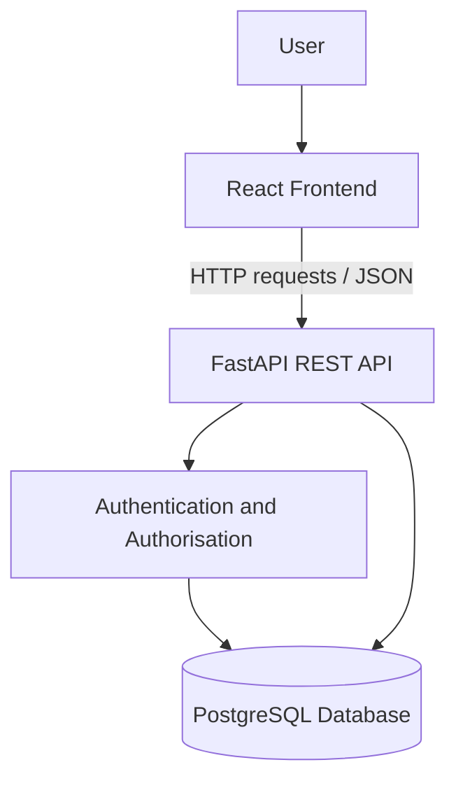

# SocialLite — Architecture and Architecture Decision Record

## 1. System Architecture

SocialLite uses a three-layer architecture consisting of a React frontend, a FastAPI backend, and a PostgreSQL database.

### Architecture Diagram

### Component Responsibilities

| Component        | Technology                | Responsibility                                                    |
| ---------------- | ------------------------- | ----------------------------------------------------------------- |
| Frontend         | React and Vite            | User interface, forms, feed display, and API requests             |
| Backend          | Python and FastAPI        | API endpoints, validation, authentication, and application logic  |
| Database         | PostgreSQL                | Persistent storage for users, posts, and related data             |
| Authentication   | JWT-based authentication  | Identifies authenticated users and protects restricted operations |
| Testing          | Pytest                    | Automated verification of backend functionality                   |
| Version control  | Git and GitHub            | Source-code history, collaboration, and project tracking          |
| Containerisation | Docker and Docker Compose | Consistent application setup and execution                        |

## 2. Data Flow

1. A user interacts with the React frontend.
2. The frontend sends an HTTP request to the FastAPI backend.
3. The backend validates the request and checks authentication or permissions where required.
4. The backend reads or updates the PostgreSQL database.
5. The backend returns a response, usually in JSON format.
6. The frontend displays the result to the user.

## 3. Security Considerations

* Passwords must be stored using a suitable password-hashing algorithm rather than as plain text.
* Restricted operations must verify the identity and permissions of the requesting user.
* JWT signing secrets must be supplied through environment configuration and must not be committed to the repository.
* Input validation should be applied to user-submitted data.
* Database credentials should be kept out of source code.

## 4. Architecture Decision Record — ADR-001

### Title

Use a React frontend, FastAPI backend, and PostgreSQL database.

### Status

Accepted for the current project implementation.

### Context

SocialLite requires a web interface, an API for application functionality, persistent storage, and authentication. The design should be understandable, testable, and suitable for local development and containerisation.

### Decision

Use React with Vite for the frontend, FastAPI for the backend API, and PostgreSQL for persistent data storage. Keep frontend presentation logic separate from backend business logic and database operations.

### Alternatives Considered

| Alternative                     | Advantages                             | Disadvantages                                                                      |
| ------------------------------- | -------------------------------------- | ---------------------------------------------------------------------------------- |
| A single monolithic application | Fewer separate components to configure | Less separation between presentation and backend responsibilities                  |
| Flask instead of FastAPI        | Lightweight and flexible               | More API validation and documentation decisions may need to be configured manually |
| SQLite instead of PostgreSQL    | Simple local setup                     | Less representative of a multi-service PostgreSQL deployment                       |
| A server-rendered frontend      | Can simplify some application flows    | Does not match the selected React frontend approach                                |

### Consequences and Trade-offs

**Benefits**

* Clear separation of frontend, API, and data storage.
* React supports reusable interface components.
* FastAPI supports API validation and interactive API documentation.
* PostgreSQL provides persistent relational data storage.
* The separate components can be tested and configured independently.

**Costs and limitations**

* More configuration is required than for a single-process application.
* Frontend and backend integration must be tested.
* Database availability and environment configuration affect application startup.
* Authentication, error handling, and deployment configuration require additional work.

### Validation

The decision should be evaluated by checking that the frontend can communicate with the backend, the backend can persist and retrieve data from PostgreSQL, protected operations enforce authentication, and the application can be started using the documented setup instructions.

## 5. Conclusion

This architecture separates user-interface responsibilities, application logic, and persistent data storage. The decision provides a clear structure for developing, testing, and maintaining the SocialLite MVP. Any unverified implementation details should be confirmed through testing before the project is submitted.
